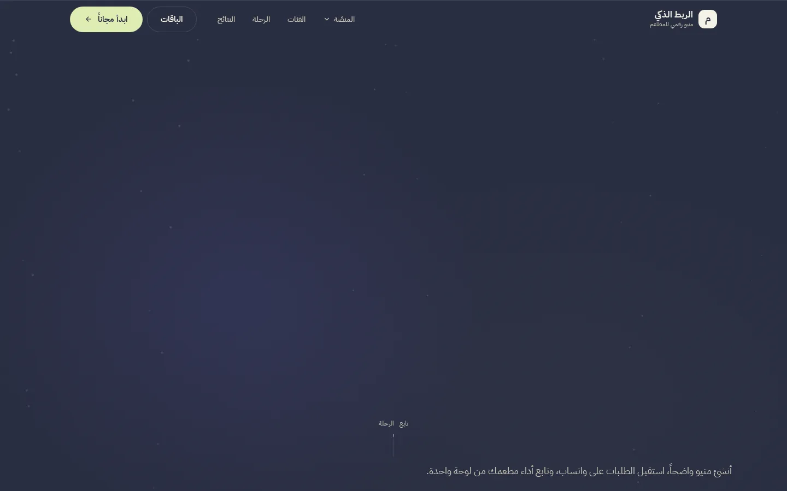
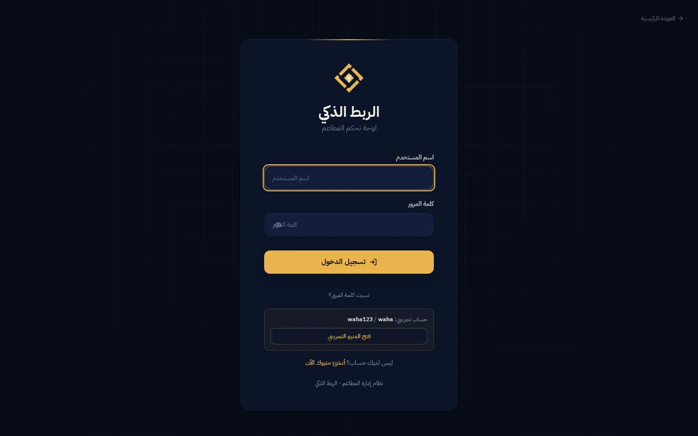

# 🍽️ Smart Menu | الربط الذكي

**منيو رقمي وطلبات واتساب للمطاعم — منصة SaaS عربية RTL مبنية على Next.js 16.**

> 🌐 [العربية](./README.md) · **English**

**A complete SaaS for restaurant digital menus and WhatsApp ordering** — customers browse an interactive digital menu and send their order straight to WhatsApp; owners manage everything from a dashboard or a mobile app, with subscriptions, a Telegram admin bot, and a fully Arabic RTL experience on the Madarek design system.

> **Production:** <https://menu.smart-link.ly> · Next.js 16 · PostgreSQL (Neon) · Vercel

[](https://github.com/ahmadmedo1012/Smart-Menu/actions/workflows/ci.yml)
[](https://menu.smart-link.ly)
[](LICENSE)

---

## 🖼 At a glance

| Light mode ☀️ | Dark mode 🌙 |
|:---:|:---:|
| [](docs/screenshots/hero-light.webp) | [](docs/screenshots/hero-dark.webp) |

> More shots in the “Screenshots” section below — full captions and dimensions
> in [`docs/screenshots/README.md`](docs/screenshots/README.md).

---

## 🧭 What is Smart Menu?

- **Digital restaurant menu** — a fast public page per restaurant: sections, photos, prices, discounts, dietary tags, and modifiers.
- **WhatsApp ordering** — a multi-item cart sent as a ready WhatsApp message to the restaurant's number.
- **Owner dashboard** — real statistics, menu & order management, QR generation, CSV export.
- **Printable QR** — four customizable sizes plus a ready-to-print page per menu (`/menu/[slug]/print`).
- **Mobile app** — an Expo/React Native companion for customers and owners (see [`mobile/README.md`](mobile/README.md)).
- **SaaS subscriptions** — free and paid plans, local payments (Libyana/Madar/bank transfer), and admin approvals via a Telegram bot.

---

## ✨ Features

### 🌐 For customers
- **Interactive digital menu** — sections, photos, prices, discounts, dietary tags, and modifiers
- **Featured items section** — cinematic showcase with priority and a badge per selected item
- **Smart search** — instant search with suggestions and full keyboard navigation
- **WhatsApp ordering** — multi-item cart with full details
- **Loyalty program** — points, rewards, and redemption
- **Ratings** — trusted reviews at the item level

### 👨‍🍳 For restaurant owners
- **Dashboard** — real statistics, most popular items, latest orders
- **Menu management** — items/sections/modifiers + image upload (Vercel Blob)
- **Order management** — interactive timeline, filtering, CSV export
- **QR codes** — four sizes with customization + a ready-to-print page
- **Telegram notifications** — a full bot for approving orders and payments

### 📱 Mobile app
- **For customers** — browse the menu, build a cart with modifiers, send the order via WhatsApp
- **For owners** — log in, watch live orders (15s polling), show/print QR, manage the menu
- Expo 53 · React Native · NativeWind · Arabic RTL from the first frame — full guide in [`mobile/README.md`](mobile/README.md)

### 👑 For admins
- **Comprehensive panel** — restaurants, users, plans, revenue, system events
- **Fine-grained permissions** — a Permission system per user
- **Event monitoring** — a complete audit log (SystemEvent)

### 💳 Subscriptions
- Free and paid plans with automatic, API-level limit enforcement
- Local payment flow (Libyana/Madar/bank transfer) with admin verification
- Scheduled expiry (Vercel Cron) and periodic cleanup

---

## 🛡 Security
- httpOnly chunked cookie sessions + two-layer session verification (Edge proxy + route)
- Double CSRF (cookie + Origin) on all API routes and protected pages
- Three-channel CSP: dynamic nonce for dynamic pages, a static policy for public pages, and a strict policy for routes
- HSTS + nosniff + DENY framing + Referrer-Policy
- Database-backed rate limiting on all public routes (register/login/loyalty/rating/webhook)
- Zod validation on every input, with Arabic messages

> Vulnerability-reporting policy and support scope live in [`SECURITY.md`](SECURITY.md).

---

## 🧪 Quality gates

| Gate | Criterion |
|---|---|
| TypeScript (`pnpm typecheck`) | zero errors |
| ESLint (`pnpm lint` = eslint src/ tests/ scripts/) | `src/` completely clean — warnings live in e2e specs only |
| Vitest (unit) | grows every round — live numbers in [CI](https://github.com/ahmadmedo1012/Smart-Menu/actions/workflows/ci.yml), history in [`CHANGELOG.md`](CHANGELOG.md) |
| Playwright E2E + security | full journeys · 375/768/1440 × light/dark × payment providers matrix · qa-cross-browser teams |
| axe-core WCAG 2.x | zero baseline violations on menu pages |
| Migration chain | replayable from scratch + byte-identical to `schema.prisma` (empty diff) |

CI (GitHub Actions): the same channel as production — `prisma migrate deploy` + test seeding + build + unit + E2E + QA regression against the live production site. We deliberately do not hard-code test counts here — they change every round; the badge above and the CHANGELOG are the source of truth.

---

## 🚀 Local development

```bash
# Prerequisites: Node 24+, pnpm 11+, and a local PostgreSQL database
pnpm install
cp .env.example .env        # then edit the values — see "Environment variables" below

pnpm db:migrate             # prisma migrate deploy — exactly the production channel
pnpm db:seed                # test admin + plans (no auth loop)
pnpm dev                    # → http://localhost:3000
```

> ⚠️ Do not `export DATABASE_URL=...` in your shell: a shell variable **overrides**
> the `.env` value (neither Next.js nor Prisma replaces a variable that already
> exists in the environment) — and a foreign URL from another project (such as a
> SQLite `file:` URL) is now caught at boot by the schema guard in
> `src/lib/env.ts` with an Arabic message explaining the cause and the fix
> (`unset DATABASE_URL`).

### 🔐 Environment variables

Copy `.env.example` to `.env` and edit the values — the constraints below are enforced at boot via `src/lib/env.ts` (fail fast with an Arabic message):

| Variable | Constraint / default |
|---|---|
| `DATABASE_URL` | required · must start with `postgresql://` or `postgres://` (a SQLite/file URL is rejected early) |
| `JWT_SECRET` | required · at least 64 characters |
| `AUTH_SECRET` | required · at least 32 characters |
| `NEXT_PUBLIC_DOMAIN` | required · a valid URL (e.g. `https://example.com`) |
| `NEXT_PUBLIC_WHATSAPP_NUMBER` | required · the WhatsApp number receiving orders |
| `TELEGRAM_BOT_TOKEN` / `TELEGRAM_CHAT_ID` | optional · defaults to empty |
| `DATABASE_SCHEMA` | optional · defaults to `public` |
| `SKIP_ENV_CHECK` | skips the boot check — local/CI only, never set in production |
| `RATE_LIMIT_RELAX` | relaxes rate limits for intensive local runs — never set in production |

The secondary variables (`ADMIN_PASSWORD` · `SEED_ADMIN_*` · `ALLOW_SEED` · `WEBHOOK_URL` · `SHADOW_DATABASE_URL` · `DATABASE_POOL_MAX` · `TELEGRAM_ADMIN_IDS` · `TELEGRAM_GROUP_IDS` · `TELEGRAM_WEBHOOK_SECRET` · `BLOB_READ_WRITE_TOKEN` · `CRON_SECRET` · `PORT`) are documented as comments inside `.env.example` itself — the full reference is in `PROJECT.md`.

### 🧪 Running E2E (Playwright)

```bash
pnpm test                    # unit (Vitest) — no server needed
pnpm test:e2e                # security + api + ui + auth-verify projects
npx playwright test --project=qa-teams      # team journeys (team1-11)
```

- **`BASE_URL`**: defaults to `http://localhost:3000` — to run against production:
  `BASE_URL=https://menu.smart-link.ly npx playwright test ...`
- Requires a running server (`pnpm dev`) + test seeding (`pnpm db:seed` — the `admin` account)
- Playwright browsers install once after cloning: `npx playwright install` (on Debian/CI: `--with-deps`; the `qa-cross-browser` branches need `firefox webkit` — details in `tests/README.md` §2)
- For intensive local runs: `RATE_LIMIT_RELAX=1` on the server process itself (see `tests/README.md`)
- The remaining projects live in `playwright.config.ts`: `qa-cross-browser` (firefox/webkit) · `round79-c`

### Credentials after test seeding
| User | Password | Role |
|---|---|---|
| `admin` | `admin123456` | full admin (development only) |

> CI seeds automatically via `scripts/ci-seed.mjs`. Production is managed by the account owner.

### 📱 Running the mobile app

```bash
cd mobile && pnpm install && npx expo start
```

The complete setup (Expo variables, EAS builds, the dual pnpm-version trap) is in [`mobile/README.md`](mobile/README.md).

---

## 🛠 Tech stack
- **Framework**: Next.js 16 (App Router, proxy middleware, ISR)
- **Database**: PostgreSQL + Prisma 7 — a migration chain that is replayable from scratch and byte-identical to the schema (ordering notes in `docs/ops-runbook.md` §10)
- **Styling**: Tailwind CSS 4 + shadcn/ui + Motion — the **Madarek** design system: night/gold ‎`#070B16`/`#E9B44C`‎ dark, cream/copper ‎`#FBFAF9`/`#B57438`‎ light, IBM Plex Sans Arabic (full rules in `DESIGN.md`)
- **Mobile**: Expo + React Native + NativeWind — the same Madarek night identity, RTL from the first frame
- **State**: Zustand
- **Infra**: Vercel (Cron, Blob, Analytics) + Neon
- **Testing**: Vitest + Playwright + axe-core

---

## 📁 Structure

```
smart-menu/
├── src/                     # web app (Next.js 16)
│   ├── app/
│   │   ├── (public)/        # public menu, pricing, landing, subscribe, QR print
│   │   ├── (protected)/     # owner (10 pages) + admin (13 pages)
│   │   ├── api/             # 66 API routes (check-api-auth authorization guard)
│   │   └── demo/            # demo tour
│   ├── components/          # ≈150 files (menu/ui/layout/landing)
│   ├── lib/                 # security, sessions, CSRF, rate limit, Zod
│   ├── proxy.ts             # edge CSP/CSRF/sessions
│   └── store/               # Zustand
├── mobile/                  # mobile app — Expo + React Native (mobile/README.md)
│   ├── src/
│   │   ├── app/             # App.tsx root + providers
│   │   ├── navigation/      # React Navigation 7 + navTheme
│   │   ├── screens/         # public (menu/cart) · owner (live orders/QR) · subscribe · auth · admin
│   │   ├── components/      # motion/ shared/ ui/ landing/
│   │   ├── services/        # API client — same production API as the web app
│   │   ├── lib/             # WhatsApp, receipts, Arabic errors
│   │   └── theme/           # Madarek night colors (parity with globals.css)
│   ├── plugins/             # with-force-rtl — RTL from the first frame
│   ├── eas.json / app.json  # build profiles (minSdk 25, Android App Links)
│   └── tests/               # design-parity tests
├── public/
│   ├── demo/                # 28 webp demo-menu photos
│   └── fonts/               # self-hosted fonts + OFL attribution
├── prisma/                  # schema + replayable migration chain
├── tests/                   # unit + E2E/security (qa teams 1-11) — grows every round
├── docs/                    # rounds/ + living reference + ops-runbook + mobile docs + screenshots/
└── scripts/                 # live CI tooling + archive/ for finished-round scripts
```

---

## ⌨️ Scripts

| Command | Purpose |
|---|---|
| `pnpm dev` | dev server |
| `pnpm build` | production build (DB unstick → `migrate deploy` → `prisma generate` → `next build`) |
| `pnpm start` | run the production build locally |
| `pnpm lint` / `pnpm lint:fix` | ESLint over `src/ tests/ scripts/` |
| `pnpm lint:idioms` | design-idiom tripwire — stops regression classes seen in audits |
| `pnpm typecheck` | `tsc --noEmit` |
| `pnpm test` | unit tests (Vitest — no server, `env -u DATABASE_URL`) |
| `pnpm test:e2e` | Playwright — security + api + ui + auth-verify projects |
| `pnpm db:migrate` | `prisma migrate deploy` — the production channel |
| `pnpm db:seed` | test seeding (admin + plans) |
| `pnpm verify` | the full gate: author + lint + idioms + typecheck + test + build |
| `pnpm verify:mobile` | mobile gates: typecheck + lint |
| `pnpm knip` | dead-code check |

> For contribution rules and commit conventions see [`CONTRIBUTING.md`](CONTRIBUTING.md); for the release history see [`CHANGELOG.md`](CHANGELOG.md).

---

## 🖼️ Screenshots

| Login page (dark) | From the demo menu |
|:---:|:---:|
| [](docs/screenshots/login.webp) | [](public/demo/oasis-burger.webp) [](public/demo/cappuccino.webp) [](public/demo/cheesecake.webp) |

> Full captions and dimensions live in [`docs/screenshots/README.md`](docs/screenshots/README.md) — the complete demo-menu photo set (28 webp images) is in `public/demo/`.

---

## 🛰️ Part of the Madarek Ecosystem — جزء من منظومة مدارك

> One design system across all projects · the Madarek identity: night/gold `#070B16`/`#E9B44C` dark — cream/copper `#FBFAF9`/`#B57438` light — IBM Plex Sans Arabic

| Project | Role | GitHub | Live |
|---|---|---|---|
| 🎓 **Madarek / مدارك** | Smart-learning platform for University of Zawia — the design-system reference | [github.com/ahmadmedo1012/madarek](https://github.com/ahmadmedo1012/madarek) | [madarek.onrender.com](https://madarek.onrender.com) |
| 🔗 **Smart-Link / سمارت لينك** | Digital umbrella for Libyan businesses | [github.com/ahmadmedo1012/Smart-Link](https://github.com/ahmadmedo1012/Smart-Link) | [smart-link.ly](https://smart-link.ly) |
| 🍽️ **Smart Menu / سمارت منيو** | Digital menu & WhatsApp ordering for restaurants | [github.com/ahmadmedo1012/Smart-Menu](https://github.com/ahmadmedo1012/Smart-Menu) | [menu.smart-link.ly](https://menu.smart-link.ly) |
| 🤖 **SmartBot / سمارت بوت** | Messenger bot & automation for Facebook pages | [github.com/ahmadmedo1012/SmartBot](https://github.com/ahmadmedo1012/SmartBot) | [bot.smart-link.ly](https://bot.smart-link.ly) |
| 🛍️ **Smart Order / سمارت أوردر** | Digital storefront, orders & delivery for businesses | [github.com/ahmadmedo1012/Smart-Order](https://github.com/ahmadmedo1012/Smart-Order) | [order.smart-link.ly](https://order.smart-link.ly) |

## 📜 License & ownership

Proprietary project — all rights reserved by `ahmadmedo1012`. The full legal text is in [`LICENSE`](LICENSE).

### Fonts
The primary brand face is **IBM Plex Sans Arabic** 400–700 (Arabic + Latin subsets,
self-hosted — Madarek's literal parity), alongside IBM Plex Mono and IBM Plex Serif
(Latin) with Cairo · Readex Pro · Noto Naskh Arabic fallbacks on the web, and the
`@expo-google-fonts/ibm-plex-sans-arabic` package (400–700) in the mobile app —
all under the **SIL Open Font License 1.1**; the full attribution and copyright
notice per family is in [`public/fonts/OFL-LICENSES.md`](public/fonts/OFL-LICENSES.md).
